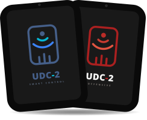

<p align="center">
  <a href="https://github.com/Quirckymistery92"></a>
  <h1 align="center">Unidad Domótica Central 2</h1>
</p>

<p align="center">
  
  <a>
    
  </a>
  
  <a>
    
  </a>
  
  <a>
    
  </a>

  <a>
    
  </a>

  <a>
    
  </a>
</p>

<p align="center">
  <a>
    
  </a>
  <a>
    
  </a>
</p>

<p align="center">
  <font size="4">Controlador Zigbee® para ambientes, corriendo en un ESP32-P4 + C6 (GUITION JC8012P4A1).
  Gestor de usuarios, ACL, sonido, reconocimiento facial, movilidad, rutinas, sensores, seguridad y las bases para un ecosistema domótico completo que que se expandirá en el futuro.  </font>
</p>

---
> [!CAUTION]
> **Baby Code**<br>
> Este proyecto está en fase de desarrollo inicial, no posee estructura completa para todas las funcionalidades que ofrece, ¡aún hay mucho por construir!

> [!NOTE]
> **Aviso de Uso y Licencia Educativa**<br>
> Este repositorio es un proyecto estrictamente personal desarrollado con fines didácticos. Se autoriza libremente la copia, modificación y redistribución del código para el aprendizaje, la experimentación y el uso compartido entre desarrolladores, siempre que no tenga fines comerciales.
> 
> *Exención de responsabilidad:* El uso de este software es bajo su propio riesgo. El autor no se hace responsable de ejecuciones indebidas, modificaciones maliciosas, daños derivados o aplicaciones fuera del marco legal vigente; dicha responsabilidad recae exclusivamente en quien lo ejecute.

---

## Características
  Además de las características físicas que ofrece **GUITION JC8012P4A1**, este firmware ofrece o planea implementar:

 - [x] Interfaz gráfica UX basada en el estilo Soft Glass.
 - [x] Gestor de usuarios.
 - [x] Control de acceso por PIN.
 - [ ] Control de acceso por Face ID.
 - [ ] Orquestador de almacenamiento (Flash / SD).
 - [ ] Controlador para la red **Zigbee** e integración completa con el firmware.
 - [ ] Sistema de seguridad interno para evitar modificaciones, alteraciones y ataques que vulneren la actividad normal del firmware.
 - [ ] Quemado y uso de firmas del eFuse.
 - [ ] Encriptación de Flash y Secure Boot.
 - [ ] Sistema de sonido y voz.
 - [ ] ACL.
 - [ ] Rutinas.
 - [ ] Detección de movilidad, on hand, on wall. `MOD. HARDWARE`
 - [ ] Gestor de carga de batería I2C `MOD. HARDWARE`

Estado de desarrollo de los boot's:
 - [x] Boot Normal <progress value="20" max="100"></progress> En progreso (20%).
 - [ ] **Boot Ofensivo.** <progress value="0" max="100"></progress> Standby
 - [ ] Recovery Boot. <progress value="0" max="100"></progress> Standby
 - [ ] Recovery NVS Boot. <progress value="0" max="100"></progress> Standby

---

## Instalación, configuraciones y flasheo.

Cloná el repositorio en tu PC, compilá y flashea, muy simple, 

### • Instalación:

> [!CAUTION]
> **Verificar la revisión del chip ESP32-P4 antes de flashear.**<br>
> Las revisiones anteriores a la v3.X (v0.x/v1.x) contienen erratas críticas de silicio y no son compatibles a nivel de compilación. Configurar correctamente el archivo `sdkconfig` acorde a la revisión del chip o este no arrancará. <br>Modificar el parámetro: `CONFIG_ESP32P4_REV_MIN_FULL`

##### 1. Descarga el proyecto en tu PC.


```bash
git clone https://github/Quirckymistery92/UDC-2.git
```

##### 2. Accedé a la carpeta raíz del proyecto.

```bash
cd UDC-2
```

### • Configuración:

##### 3. Ajustá tu proyecto al chip actual.
```bash
idf.py set-target esp32p4
```

##### 4. Configurá el SDKConfig. (AVANZADO)
```bash
# No modifique configuraciones si no sabe lo que hace.
idf.py menuconfig
```
### • Flashear:

##### 5. Compilar, flashear el ESP y monitorear en consola.
```bash
# Cambia '/dev/ttyACM0' por el número de puerto asignado en tu PC.
idf.py -p /dev/ttyACM0 flash monitor
```
---

## Documentación
 
La documentación de hardware de la placa **GUITION JC8012P4A1** la podes encontrar en este [Repositorio](https://github.com/profi-max/JC8012P4A1_BSP_ESP32P4). Actualmente está en inglés, pronto les dejaré todo el datasheet en español argentino :)

---

## Licencia

Licencia: `CC BY-NC-SA 4.0`<br>
Amo lo libre, gratuito y usable para con los míos, esta fue una decisión desde el día que arranqué en local. Espero te sirva de ayuda algo de todo esto, tengo librerías que hice yo, otras con ayuda de IA y otras por la comunidad, por eso dejo los créditos correspondientes para cada trabajo, para que todos contemplemos alianza entre programadores.

---

## Extra

Debido a que es un **proyecto personal**, no se aceptan **Pull Requests (PR)** ni contribuciones externas, ya que prefiero centrarme primero en mis propias ideas. Tengan en cuenta que el código se encuentra en un estado inicial, por lo que encontrarán errores catastróficos, incoherencias y fallas de diseño. Es un proceso largo y lento.

<br>

<a href="https://github.com/Quirckymistery92/UDC-2/">UDC-2</a> © 2025 por <a href="https://github.com/Quirckymistery92">Alex Jaque</a> está bajo licencia <a href="https://creativecommons.org/licenses/by-nc-sa/4.0/">CC BY-NC-SA 4.0</a>    

